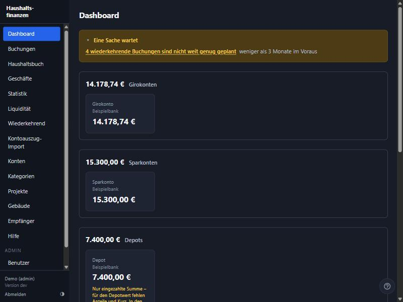
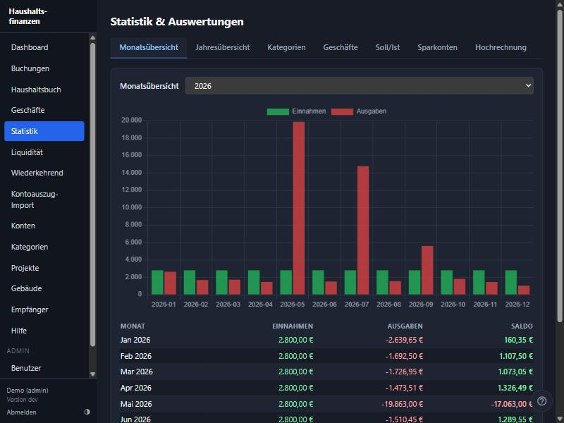
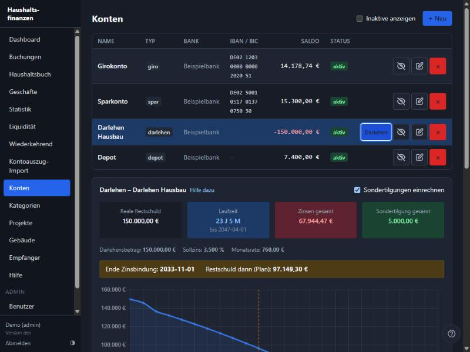

# Haushaltsfinanz-App

Finanzverwaltung für den eigenen Haushalt als Web-App (FastAPI + SQLite +
React/PWA), betrieben auf dem eigenen Rechner. Was in welcher Reihenfolge
gebaut wurde, steht im [Phasenplan](docs/phasenplan.md).

### ▶ [Rundgang durch die App](https://schlotti73.github.io/Haushaltsfinanzen/demo/)

Alle Bereiche mit Screenshots und Erklärung, ohne etwas zu installieren.

## Die App auf einen Blick

Kontoauszüge als PDF einlesen, Kassenzettel fotografieren und auf Kategorien aufteilen,
Darlehen hochrechnen, Nebenkosten je Zähler abrechnen, Liquidität vorausschauen.

| Dashboard | Statistik | Darlehen |
|---|---|---|
|  |  |  |

Alle gezeigten Zahlen und Namen sind erfunden. Die ausführliche Vorstellung aller
Bereiche steht im [Rundgang](https://schlotti73.github.io/Haushaltsfinanzen/demo/)
(im Repository: [`docs/demo/index.html`](docs/demo/index.html)).
Den Datensatz dahinter erzeugt `scripts/seed_demo.py` reproduzierbar neu, ohne eine Zeile
echter Daten; die verwendeten Platzhalter-Namen stehen in
[`docs/beispieldaten.md`](docs/beispieldaten.md).

## Projektstruktur

```
db/schema.sql              SQLite-Schema (finales Datenmodell)
config-vorlagen/           Saat-Daten aus dem Repo (Kategorie-Baum, Mapping)
config/                    Einstellungen des Rechners (Port, DB-Pfad, Backup)
scripts/init_db.py         Erzeugt finanzen.db + Stammdaten
docs/                      Konzept-Dokumente (Datenmodell, Mapping, wiederkehrende Buchungen)
finanzen.db                generierte Datenbank (nicht im Git)
```

## Datenbank anlegen

```powershell
python scripts/init_db.py            # legt finanzen.db an
python scripts/init_db.py --force    # neu erzeugen (überschreibt)
```

## Status

Im täglichen Einsatz, aktuelle Fassung v0.2.6. Die 15 Phasen des
[Phasenplans](docs/phasenplan.md) sind abgeschlossen; was dabei entstanden ist:

| Bereich | Stand |
|---|---|
| Buchungen, Kategorien (3 Ebenen), Empfänger, Konten | fertig |
| Kontoauszug-Import als PDF (Postbank, ING, Sparkasse) mit Dublettenschutz | fertig |
| Zweistufige Import-Regeln, Abgleich mit Amazon-CSV | fertig |
| Haushaltsbuch: Belegfotos, Texterkennung, Aufteilung auf Kategorien | fertig |
| Wiederkehrende Buchungen und Liquiditätsvorschau | fertig |
| Statistik, Dashboard, Geschäfte und Artikel-Kategorien | fertig |
| Darlehen mit Annuität, Sondertilgung und Hochrechnung | fertig |
| Projekte mit Plan-Ist-Vergleich | fertig |
| Gebäude: Zähler, Zählerstände, Nebenkosten je Einheit | fertig |
| Mehrere Datenbanken, Backup, Windows-Dienst, Docker-Image, Update-Prüfung | fertig |
| Anmeldung mit zweitem Faktor außerhalb des Heimnetzes | fertig |
| Hilfe zu allen Bereichen, im Rahmen über den `?`-Knopf erreichbar | fertig |

Noch offen aus Phase 5: der Abgleich geplanter gegen tatsächlich gebuchte Beträge
(Status „geplant" → „gebucht") und die Aufteilung einer Buchung – nicht nur eines
Belegs – auf mehrere Kategorien. Ein Live-Abruf von Artikeldaten aus Online-Shops
wurde verworfen: für private Käufe gibt es keine Schnittstelle, und Scraping
scheitert an AGB und Zwei-Faktor-Anmeldung.

## Lizenz

[MIT](LICENSE) – Nutzung, Änderung und Weitergabe sind erlaubt, solange der
Copyright-Hinweis erhalten bleibt. Die Software kommt ohne Gewährleistung.
